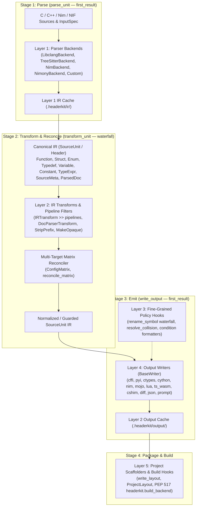

# headerkit

[](https://github.com/axiomantic/headerkit/actions/workflows/ci.yml)
[](https://axiomantic.github.io/headerkit/)
[](https://pypi.org/project/headerkit/)
[](https://pypi.org/project/headerkit/)
[](https://github.com/axiomantic/headerkit/blob/main/LICENSE)

> **The universal C/C++ interop toolkit.**
> Generates production-ready bindings for Python, Nim, Mojo, LuaJIT, TypeScript/Wasm, and C shims.

HeaderKit parses native C and C++ headers into a normalized intermediate representation (IR). From that single IR, it generates foreign language bindings, tracks breaking API/ABI diffs, reconciles multi-platform matrices, and compresses headers for LLM prompt windows.

---

## What are you looking to do?

| Goal | Quick Command / Action | Section |
| :--- | :--- | :--- |
| **Generate Python bindings** (ctypes, CFFI, Cython) | `headerkit mylib.h -w ctypes -o ctypes:bindings.py` | [Python Bindings](#1-generate-python-bindings-ctypes-cffi-cython) |
| **Generate Mojo, Nim, or LuaJIT bindings** | `headerkit mylib.h -w mojo -o mojo:mylib.mojo` | [Systems & Scripting](#2-generate-systems--scripting-bindings-mojo-nim-luajit) |
| **Wrap C++ classes in a C-ABI shim** (`extern "C"`) | `headerkit mylib.hpp -w cshim -o cshim:mylib_cshim.cpp` | [C Shim Wrappers](#3-wrap-c-classes-in-a-c-abi-shim) |
| **Parse C/C++ without LLVM/libclang** | `headerkit mylib.h -b tree-sitter -w ctypes` | [Zero-Dependency Parsing](#4-zero-dependency-parsing-with-tree-sitter) |
| **Detect breaking API changes between versions** | `DiffWriter(baseline=v1, format="markdown").write(v2)` | [API Diffing](#5-detect-breaking-api-changes) |
| **Compress headers for LLM prompt windows** | `headerkit mylib.h -w prompt` | [LLM Context](#6-compress-headers-for-llm-prompts) |
| **Ship wheels without requiring libclang on user machines** | `headerkit cache populate mylib.h -w cffi` | [Build Backend & Cache](#7-ship-wheels-without-requiring-libclang) |
| **Inspect IR programmatically** | `headerkit mylib.h -w json -o json:ast.json` | [Programmatic IR](#8-inspect-ir-programmatically) |
| **Transform IR with composable pipelines** | `unit >> StripPrefix("ma_") >> MakeOpaque("device")` | [IR Pipelines](#9-transform-ir-with-composable-pipelines) |
| **Reconcile multi-target configuration matrices** | `headerkit add-target bindings.nim --target x86_64-pc-windows-msvc` | [Matrix Reconciliation](#10-reconcile-multi-platform-matrices--incremental-updates) |

---

## Why HeaderKit?

Traditional binding generators (SWIG, bindgen, ctypesgen) couple parser internals directly to single-target code emitters. Keeping bindings updated across multiple languages and platforms as upstream libraries evolve is an error-prone chore.

HeaderKit solves this with three core design pillars:

1. **Strictly Layered Compiler Pipeline**: HeaderKit separates C/C++ parsing (`LibclangBackend`, `TreeSitterBackend`), composable AST transforms (`IRTransform`), and target code generation (`BaseWriter`) across a language-agnostic Intermediate Representation (`SourceUnit`).
2. **Easily Extended to Any Source or Target Language**: Built on a unified hook engine (`headerkit.hooks`). Write a custom backend, transform, or target writer in ~50 lines of Python using typed [`SourceUnit`][headerkit.ir.SourceUnit] IR and register it via standard Python entry points or config files without touching core code.
3. **Automated Upstream Updates & Zero-Dependency Downstream**: Keep bindings in lockstep with upstream releases. HeaderKit's PEP 517 build backend and committed cache store (`.headerkit/`) let downstream consumers `pip install` wheels without needing `libclang` or system compilers installed.

---

## Quick Solutions

Every example below assumes this sample C header:

```c
// mylib.h
typedef struct { int x, y; } Point;
int distance(const Point *a, const Point *b);
```

### 1. Generate Python Bindings (ctypes, CFFI, Cython)

Generate zero-build ctypes modules, CFFI cdef declarations, or compiled Cython `.pxd` headers:

```bash
# Drop-in Python ctypes module (zero build step)
headerkit mylib.h -w ctypes -o ctypes:bindings.py

# CFFI declarations for ffibuilder.cdef()
headerkit mylib.h -w cffi -o cffi:_defs.cdef.txt

# Cython .pxd declaration file for compiled C/C++ interop
headerkit mylib.h -w cython -o cython:mylib.pxd
```

*See the [ctypes Reference](https://axiomantic.github.io/headerkit/reference/ctypes/), [CFFI Guide](https://axiomantic.github.io/headerkit/guides/cffi/), and [Cython Reference](https://axiomantic.github.io/headerkit/reference/cython/).*

### 2. Generate Systems & Scripting Bindings (Mojo, Nim, LuaJIT)

Bridge C and C++ libraries into modern systems and scripting runtimes:

```bash
# Mojo module with DLHandle dynamic symbol loading
headerkit mylib.h -w mojo -o mojo:mylib.mojo

# Native Nim module with {.importc.} pragma bindings
headerkit mylib.h -w nim -o nim:mylib.nim

# LuaJIT FFI bindings with ffi.cdef[[ ... ]]
headerkit mylib.h -w lua -o lua:mylib_ffi.lua
```

*See the [Mojo Reference](https://axiomantic.github.io/headerkit/reference/mojo/), [Nim Reference](https://axiomantic.github.io/headerkit/reference/nim/), and [LuaJIT Reference](https://axiomantic.github.io/headerkit/reference/lua/).*

### 3. Wrap C++ Classes in a C-ABI Shim

Directly binding complex C++ classes across foreign function interfaces is fragile due to mangled symbols and exception boundaries. The `cshim` writer automatically generates an `extern "C"` wrapper library with opaque handles and exception guards:

```bash
headerkit mylib.hpp -w cshim -o cshim:mylib_cshim.cpp
```

```cpp
// generated mylib_cshim.cpp
#include "mylib.hpp"

extern "C" {
typedef void* PointHandle;
PointHandle Point_create(int x, int y) { return new Point(x, y); }
void Point_destroy(PointHandle self) { delete static_cast<Point*>(self); }
}
```

*See the [CShim Reference](https://axiomantic.github.io/headerkit/reference/cshim/).*

### 4. Zero-Dependency Parsing with Tree-Sitter

When system LLVM / `libclang` is not installed or in lightweight CI environments, HeaderKit can parse C and C++ headers directly using precompiled Tree-sitter grammars (`tree-sitter-c` and `tree-sitter-cpp`):

```bash
# Parse C header using tree-sitter backend
headerkit mylib.h -b tree-sitter -w ctypes -o ctypes:bindings.py

# Parse C++ header using tree-sitter backend
headerkit mylib.hpp -b tree-sitter -w cython -o cython:mylib.pxd
```

*See the [Tree-sitter Backend Guide](https://axiomantic.github.io/headerkit/reference/treesitter/).*

### 5. Detect Breaking API Changes

Compare two versions of a C/C++ header to detect signature mutations, missing struct fields, altered enum values, and type changes:

```python
from headerkit.backends import get_backend
from headerkit.writers.diff import DiffWriter

backend = get_backend("libclang")
old_api = backend.parse('#include "mylib_v1.h"', "v1.h")
new_api = backend.parse('#include "mylib_v2.h"', "v2.h")

print(DiffWriter(baseline=old_api, format="markdown").write(new_api))
```

*See the [Diff Writer Reference](https://axiomantic.github.io/headerkit/reference/diff/).*

### 6. Compress Headers for LLM Prompts

Large C/C++ headers waste tokens and clutter context windows with preprocessor noise and implementation details. The `prompt` writer produces a dense, token-optimized summary designed for LLM prompts:

```bash
headerkit mylib.h -w prompt
```

```text
// mylib.h (headerkit compact)
STRUCT Point {x:int, y:int}
FUNC distance(a:const Point*, b:const Point*) -> int
```

*See the [Prompt Writer Reference](https://axiomantic.github.io/headerkit/reference/prompt/).*

### 7. Ship Wheels Without Requiring libclang

HeaderKit includes a two-layer cache (`.headerkit/`) storing parsed IR and generated bindings. Commit the cache to version control and downstream users can install wheels without having `libclang` or LLVM installed:

```bash
# Populate cache across multiple architecture targets
headerkit cache populate mylib.h -w cffi --platform linux/amd64 --platform linux/arm64
git add .headerkit/ && git commit -m "cache: populate bindings"
```

In your project's `pyproject.toml`, declare the PEP 517 build backend to automatically regenerate bindings during `pip install`:

```toml
[build-system]
requires = ["headerkit", "hatchling"]
build-backend = "headerkit.build_backend"
```

*See the [Cache Guide](https://axiomantic.github.io/headerkit/guides/cache/) and [Build Backend Guide](https://axiomantic.github.io/headerkit/guides/build-backend/).*

### 8. Inspect IR Programmatically

Parse headers directly into a strongly typed Python AST or serialize them to JSON for downstream code generators, linters, or analysis tools:

```python
from headerkit import generate
from headerkit.backends import get_backend

# Serialized JSON IR
json_ir = generate("mylib.h", "json")

# Typed Python AST
backend = get_backend("libclang")
unit = backend.parse('#include "mylib.h"', "mylib.h")
for decl in unit.declarations:
    print(decl.name, type(decl))
```

*See the [IR Reference](https://axiomantic.github.io/headerkit/reference/ir/) and [JSON Reference](https://axiomantic.github.io/headerkit/reference/json/).*

### 9. Transform IR with Composable Pipelines

Mutate, filter, rename, or splice IR trees between parser extraction and code generation using visitor pipelines and the `>>` operator:

```python
from headerkit.backends import get_backend
from headerkit.transforms import MakeOpaque, StripPrefix

backend = get_backend("libclang")
unit = backend.parse_source("include/miniaudio.h")

# Strip naming prefixes and make internal structs opaque
pipeline = StripPrefix("ma_") >> MakeOpaque("device")
transformed_unit = pipeline.transform(unit)
```

*See the [IR Transformations Guide](https://axiomantic.github.io/headerkit/guides/ir_transformations/) and [Transforms Reference](https://axiomantic.github.io/headerkit/reference/transforms/).*

### 10. Reconcile Multi-Platform Matrices & Incremental Updates

Evaluate headers across multi-dimensional matrices (target platforms, library versions, feature flags), minimize boolean guards algebraically, and evolve bindings incrementally:

```python
from headerkit.matrix import ConfigMatrix, probe_configuration
from headerkit.reconcile import reconcile_matrix
from headerkit.writers import get_writer

# 1. Define configuration matrix
matrix = ConfigMatrix()
matrix.add_dimension(
    "target", ["x86_64-apple-darwin", "x86_64-unknown-linux-gnu", "x86_64-pc-windows-msvc"], dimension_type="target"
)

# 2. Probe and reconcile
matrix_units = [(cond, probe_configuration("audio.h", cond)) for cond in matrix.resolve()]
reconciled = reconcile_matrix(matrix_units, matrix=matrix, target_lang="nim")

# 3. Emit polyglot conditional bindings
code = get_writer("nim").write(reconciled)
```

To incrementally add a new platform target to an existing binding file without losing manual edits inside `@headerkit:override` blocks:

```bash
headerkit add-target bindings/audio.nim --target aarch64-unknown-linux-gnu
```

*See the [Configuration Matrix Guide](https://axiomantic.github.io/headerkit/guides/configuration_matrix/), [Reconciliation Guide](https://axiomantic.github.io/headerkit/guides/matrix_reconciliation_and_overrides/), and [Reconcile Reference](https://axiomantic.github.io/headerkit/reference/reconcile/).*

---

## Installation

```bash
pip install headerkit
```

Requires Python 3.11+ (zero runtime dependencies).

To install the optional `libclang` parser backend (if not already present on your system):

```bash
headerkit install-libclang
```

Or install it via your system package manager:

| Platform | Command |
| :--- | :--- |
| **macOS** | `brew install llvm` or Xcode Command Line Tools |
| **Ubuntu / Debian** | `sudo apt install libclang-dev` |
| **Fedora / RHEL** | `sudo dnf install clang-devel` |
| **Windows** | `winget install LLVM.LLVM` or [LLVM releases](https://github.com/llvm/llvm-project/releases) |

*HeaderKit vendors LLVM bindings supporting libclang 14 through 23.*

---

## CLI Reference

```text
headerkit [options] HEADER_OR_GLOB [HEADER_OR_GLOB ...]
```

### Options

| Flag | Description |
| :--- | :--- |
| `-b NAME`, `--backend NAME` | Parser backend (default: `libclang`, or `tree-sitter`) |
| `-w WRITER`, `--writer WRITER` | Output writer to invoke (repeatable) |
| `-o WRITER:PATH`, `--output` | Output destination template (repeatable, e.g. `ctypes:bindings.py`) |
| `-I DIR`, `--include-dir DIR` | Add include directory (repeatable) |
| `-D MACRO[=VALUE]` | Define preprocessor macro (repeatable) |
| `--backend-arg ARG` | Pass extra argument to the parser backend |
| `--writer-opt WRITER:KEY=VALUE` | Pass writer-specific options (repeatable) |
| `--store-dir DIR` | Cache store directory (default: `.headerkit/`) |
| `--target TRIPLE` | Target triple for cross-compilation (e.g. `aarch64-apple-darwin`) |
| `--no-cache` | Disable all cache lookups |
| `--config PATH` | Path to explicit `.headerkit.toml` config file |
| `--no-config` | Skip loading configuration files |
| `--version` | Display version and exit |

---

## Configuration File

HeaderKit automatically reads configuration from `.headerkit.toml` or the `[tool.headerkit]` table in `pyproject.toml`:

```toml
# .headerkit.toml
backend = "libclang"
writers = ["ctypes", "cffi"]
include_dirs = ["/usr/local/include"]

[writer.ctypes]
lib_name = "mylib"

[writer.cffi]
exclude_patterns = ["^__", "^_internal"]
```

Values support `${ENV_VAR}` expansion for build-time paths injected by CMake or CI systems.

---

## Extensibility & Architecture Pipeline

HeaderKit enforces a strict, one-way compiler pipeline where every stage communicates exclusively through the canonical [`SourceUnit`][headerkit.ir.SourceUnit] (`Header`) Intermediate Representation. Five orthogonal extension layers let you customize or extend any stage without modifying core code:



### The 5 Extension Layers & Separation of Concerns

| Layer | Hook / Protocol | Responsibility | Strict Boundary Invariant |
| :--- | :--- | :--- | :--- |
| **1. Parser Backends** | `ParserBackend`, `@hook("parse_unit")`, `register_backend()` | Parse C/C++/Nim/NIF sources into canonical `SourceUnit` (`Header`) IR (`LibclangBackend` primary; `TreeSitterBackend` fallback; `NimBackend` & `NimonyBackend` for Nim 2.x / Nimony NIF). | Backends never emit target-language syntax or embed foreign-generator hacks; they record factual C/C++ ABI and `SourceMeta` semantics in the IR. |
| **2. IR Transforms & Filters** | `IRTransform`, `>>` operator, `@hook("transform_unit")`, `@hook("parse_doc")`, `register_transform()` | Pure `SourceUnit -> SourceUnit` AST passes (`StripPrefix`, `MakeOpaque`, `FilterBySymbol`, `DocParserTransform`) and `reconcile_matrix`. | Transforms mutate or enrich IR nodes without importing or coupling to concrete output writers. |
| **3. Fine-Grained Policy Hooks** | `@hook("rename_symbol")`, `@hook("resolve_collision")`, `[rename]` in `.headerkit.toml` | Priority-tiered (`FALLBACK` $\to$ `STANDARD` $\to$ `PROJECT` $\to$ `OVERRIDE`) identifier renaming, casing, lexical legality, and collision resolution. | Project renamers (`Priority.PROJECT`) run before target-language lexer legality guards (`Priority.FALLBACK`), so custom rules cannot produce illegal target identifiers. |
| **4. Output Writers** | `BaseWriter`, `@hook("write_output")`, `register_writer()` | Pure `SourceUnit -> str` code generators (`cffi`, `pyi`, `ctypes`, `cython`, `nim`, `mojo`, `lua`, `ts_wasm`, `cshim`, `diff`, `json`, `prompt`). | **Pure IR-only boundary**: writers are 100% backend-agnostic (zero `headerkit.backends` imports, zero raw C prototype strings parsed inside writer options, no guessing from C type spellings). |
| **5. Project Scaffolders & Build Hooks** | `BaseWriter.write_layout()`, `ProjectLayout`, `headerkit.build_backend` | Multi-file project scaffolding (CMake, `pyproject.toml`, `.nimble`, tripwires, test harnesses) and PEP 517 wheel builds backed by `.headerkit/`. | Downstream `pip install` consumes committed `.headerkit/` IR/output caches deterministically without requiring `libclang` or LLVM on user machines. |

### Registering Custom Plugins

Register third-party plugins in your own package via `pyproject.toml` entry points:

```toml
[project.entry-points."headerkit.backends"]
mybackend = "mypkg.backend:MyBackend"

[project.entry-points."headerkit.writers"]
mywriter = "mypkg.writer:MyWriter"
```

Or write a custom writer in Python:

```python
from headerkit.ir import SourceUnit
from headerkit.writers import BaseWriter, register_writer


class RubyFfiWriter(BaseWriter):
    @property
    def name(self) -> str:
        return "ruby"

    def write(self, unit: SourceUnit) -> str:
        lines = ["require 'ffi'", "module MyLib", "  extend FFI::Library"]
        # Iterate over unit.declarations...
        return "\n".join(lines)


register_writer("ruby", RubyFfiWriter)
```

*See the [Architecture Guide](https://axiomantic.github.io/headerkit/guides/architecture/) and [Custom Writers Guide](https://axiomantic.github.io/headerkit/guides/custom-writers/).*

---

## Roadmap

- **Origin Library Versioning & ABI Multi-Version Metadata**: Track signatures across multiple upstream release versions to generate version-guarded symbols and automated migration shims.
- **Bi-directional Bridges**: Generate C/C++ header interfaces and C export shims from high-level Python and Mojo source definitions.
- **Grammar-Based Polyglot Source Extraction**: Extract C-ABI interfaces from Rust, Zig, and Nim source code into normalized IR using formal Tree-sitter grammars (`tree-sitter-rust`, `tree-sitter-zig`, `tree-sitter-nim`).
- **Expanded Target Writers**: Additional turnkey writers for Rust (`bindgen`-free FFI), Go (`cgo`), and Swift.

---

## Development

```bash
git clone https://github.com/axiomantic/headerkit.git
cd headerkit
pip install -e '.[dev]'
pytest
```

---

## License

HeaderKit is open source licensed under the [MIT License](LICENSE).

Vendored LLVM clang Python bindings in `headerkit/_clang/` are licensed under the [Apache License v2.0 with LLVM Exceptions](headerkit/_clang/LICENSE).
