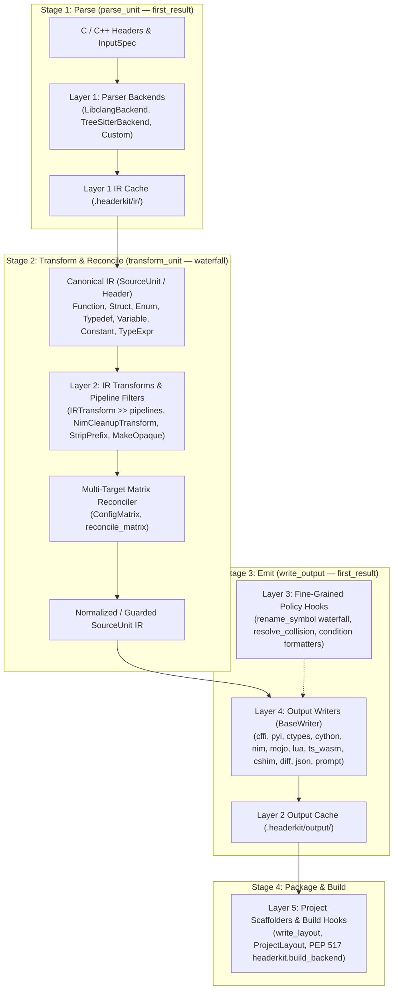
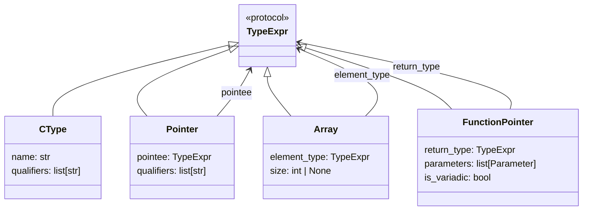
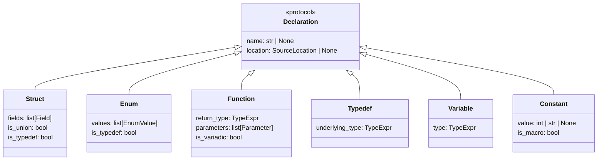

# Architecture Overview

headerkit is organized around a unified, hook-driven pipeline: **backends** parse source units into an **IR** (Intermediate Representation) rooted at `SourceUnit`, optional **transform hooks** apply AST mutations or dialect adaptations, and **writers** consume the IR to generate target output.

## The Pipeline

HeaderKit is structured as a 4-stage, one-way compiler pipeline with 5 orthogonal extension layers:



Each stage is decoupled through the unified hook engine (`headerkit.hooks`) and communicates exclusively through the canonical [`SourceUnit`][headerkit.ir.SourceUnit] (`Header`) IR. Backends know nothing about writers. Writers know nothing about backends. The IR is the sole contract between them.

## Extensibility & Separation of Concerns (The 5 Extension Layers)

1. **Layer 1 — Parser Backends (`headerkit.backends` / `parse_unit`)**:
   - **Role**: Parse C/C++ source headers into canonical `SourceUnit` (`Header`) IR dataclasses. `LibclangBackend` is the primary production parser (full preprocessor expansion, macro evaluation, and compiler AST semantics); `TreeSitterBackend` is a lightweight zero-LLVM fallback.
   - **Extension Point**: Implement `ParserBackend` and call `register_backend()`, register `@hook("parse_unit")`, or declare `[project.entry-points."headerkit.backends"]`.
   - **Boundary Invariant**: Backends record factual C/C++ semantics in the IR (`is_typedef`, `is_elaborated`, `underlying_type`, `language`) without target-writer assumptions or foreign-generator hacks.

2. **Layer 2 — IR Transforms & Pipeline Filters (`headerkit.transforms` / `transform_unit`)**:
   - **Role**: Registry-driven IR-to-IR (`SourceUnit -> SourceUnit`) passes (`StripPrefix`, `MakeOpaque`, `FilterBySymbol`, `NimCleanupTransform`, `NimJsonDocEnricher`) and multi-target matrix reconciliation (`ConfigMatrix`, `reconcile_matrix`).
   - **Extension Point**: Subclass `IRTransform` and compose with `>>`, call `register_transform()`, or register `@hook("transform_unit")` in the waterfall pipeline.
   - **Boundary Invariant**: Transforms operate purely on IR nodes (plus optional pre-parse `prepare_parse()` / `backend_options()` hooks) and never import concrete writers.

3. **Layer 3 — Fine-Grained Policy Hooks (`headerkit.hooks` / `rename_symbol`, `resolve_collision`)**:
   - **Role**: Priority-tiered (`Priority.FALLBACK = 10`, `STANDARD = 50`, `PROJECT = 100`, `OVERRIDE = 1000`) hooks governing symbol renaming, casing, target-language lexical legality, and identifier collision resolution, plus `BaseWriter` condition formatters (`format_platform_condition`, `format_matrix_condition`).
   - **Extension Point**: Configure declarative `[rename]` rules in `.headerkit.toml` or register `@hook("rename_symbol")` (waterfall) and `@hook("resolve_collision")` (first-result).
   - **Boundary Invariant**: Project renamers (`Priority.PROJECT`) execute before writer lexical legality hooks (`Priority.FALLBACK`), ensuring custom naming rules can never emit an invalid target-language identifier.

4. **Layer 4 — Output Writers (`headerkit.writers` / `write_output`)**:
   - **Role**: Pure `SourceUnit -> str` code generators (`BaseWriter` subclasses: `cffi`, `pyi`, `ctypes`, `cython`, `nim`, `mojo`, `lua`, `ts_wasm`, `cshim`, `diff`, `json`, `prompt`).
   - **Extension Point**: Subclass `BaseWriter` and call `register_writer()`, register `@hook("write_output")`, or declare `[project.entry-points."headerkit.writers"]`.
   - **Boundary Invariant**: Writers consume **IR only**. A writer must never import `headerkit.backends`, call `get_backend()`, accept unparsed C/C++ prototype strings in writer options to parse on the side, or guess semantics from C type spellings. All declarations (including `extern "Python"` callbacks) must exist in `Header.declarations` first; writer options only reference IR symbol names or configure emission policy.

5. **Layer 5 — Project Scaffolders & Build Hooks (`write_layout` / `headerkit.build_backend`)**:
   - **Role**: Multi-file project layout emission (`BaseWriter.write_layout()`, `ProjectLayout`, CMakeLists, `pyproject.toml`, `.nimble`, tripwires, test harnesses) and PEP 517 build-time wheel integration (`headerkit.build_backend`) backed by the two-layer `.headerkit/` cache.
   - **Extension Point**: Override `BaseWriter.write_layout()` or configure `[build-system]` with `build-backend = "headerkit.build_backend"`.
   - **Boundary Invariant**: Downstream `pip install` builds consume committed `.headerkit/` IR and output caches deterministically without requiring `libclang` or LLVM on user machines.

## Layer 1: Backends (Parsing)

A backend implements the [`ParserBackend`][headerkit.ir.ParserBackend] protocol and converts C/C++ source code into IR.

```python
from headerkit import ParserBackend
from headerkit.ir import Header


class ParserBackend(Protocol):
    def parse(
        self,
        code: str,
        filename: str,
        include_dirs: list[str] | None = None,
        extra_args: list[str] | None = None,
        *,
        use_default_includes: bool = True,
        recursive_includes: bool = True,
        max_depth: int = 10,
        project_prefixes: tuple[str, ...] | None = None,
    ) -> Header: ...

    @property
    def name(self) -> str: ...

    @property
    def supports_macros(self) -> bool: ...

    @property
    def supports_cpp(self) -> bool: ...
```

### Built-in Backend: LibclangBackend

The `LibclangBackend` uses LLVM's libclang to parse headers. It provides:

- Full C and C++ support (templates, namespaces, classes)
- Preprocessor handling (`#include`, `#define`, `#ifdef`)
- Source location tracking for error reporting
- Recursive include processing for umbrella headers

```python
from headerkit import get_backend

backend = get_backend("libclang")
header = backend.parse(code, "myheader.h")
```

### Backend Registry

Backends register themselves using `register_backend()`:

```python
from headerkit.backends import register_backend

register_backend("mybackend", MyBackendClass, is_default=False)
```

Registry functions:

| Function | Description |
|----------|-------------|
| `get_backend(name=None)` | Get a backend instance (default if `name` is `None`) |
| `list_backends()` | List all registered backend names |
| `is_backend_available(name)` | Check if a backend is usable (real load test for libclang) |
| `register_backend(name, cls)` | Register a new backend |

See [Writing Custom Backends](custom-backends.md) for a complete guide.

## Layer 2: IR (Intermediate Representation)

The IR is a tree of Python dataclasses rooted at [`Header`][headerkit.ir.Header]. It is designed to be parser-agnostic: any backend that can parse C/C++ can produce the same IR.

### Type Expressions

Type expressions (`TypeExpr`) represent C types as composable trees:



| Class | Represents | Example |
|-------|-----------|---------|
| [`CType`][headerkit.ir.CType] | Base type with qualifiers | `int`, `const char`, `unsigned long` |
| [`Pointer`][headerkit.ir.Pointer] | Pointer to another type | `int*`, `const char*`, `void**` |
| [`Array`][headerkit.ir.Array] | Fixed or flexible array | `int[10]`, `char[]` |
| [`FunctionPointer`][headerkit.ir.FunctionPointer] | Function pointer | `void (*)(int, char*)` |

Types compose naturally:

```python
from headerkit import CType, Pointer, Array

# const char*
const_char_ptr = Pointer(CType("char", ["const"]))

# int**
int_ptr_ptr = Pointer(Pointer(CType("int")))

# const char*[]
string_array = Array(Pointer(CType("char", ["const"])))
```

### Declarations

Declarations (`Declaration`) represent top-level C/C++ constructs:



| Class | Represents |
|-------|-----------|
| [`Struct`][headerkit.ir.Struct] | Structs, unions, and C++ classes |
| [`Enum`][headerkit.ir.Enum] | Enumerations with named constants |
| [`Function`][headerkit.ir.Function] | Function prototypes |
| [`Typedef`][headerkit.ir.Typedef] | Type aliases |
| [`Variable`][headerkit.ir.Variable] | Global/extern variables |
| [`Constant`][headerkit.ir.Constant] | `#define` macros and `const` values |

### The SourceUnit Container

[`SourceUnit`][headerkit.ir.SourceUnit] (with backward-compatible alias [`Header`][headerkit.ir.Header]) is the top-level container returned by all backends:

```python
from headerkit.ir import SourceUnit

# SourceUnit fields:
#   path: str                        -- original file path or synthetic name
#   declarations: list[Declaration]  -- all extracted declarations
#   included_headers: set[str]       -- basenames of included headers
#   language: str                    -- source language (e.g., "c", "cpp")
#   classification: str              -- classification (e.g., "header", "source")
```

## Layer 3: Writers (Output)

Writers convert [`SourceUnit`][headerkit.ir.SourceUnit] IR into code, definitions, or packages. Concrete writers inherit from [`BaseWriter`][headerkit.writers.BaseWriter] (which satisfies the underlying [`WriterBackend`][headerkit.writers.WriterBackend] protocol).

`BaseWriter` unifies single-string rendering (`write()`) and multi-file layout emission (`write_layout()`):

```python
from headerkit.ir import SourceUnit
from headerkit.writers import BaseWriter, WriterOption
from headerkit.writers.base import ProjectLayout, ScaffoldOptions


class MyWriter(BaseWriter):
    name: str = "mywriter"
    format_description: str = "My custom bindings"

    def _render(self, unit: SourceUnit) -> str:
        # Generate the primary output string
        ...
```

Writers declare their supported layout modes (`supported_layouts`) and configuration options (`supported_options`). Writer-specific options are passed to the constructor or via `--writer-opt`.

### Built-in Writers

| Writer | Registry Name | Output | Primary Options |
|---|---|---|---|
| [`CffiWriter`][headerkit.writers.cffi.CffiWriter] | `cffi` (default) | CFFI `cdef` strings | `exclude_patterns: list[str] \| None` |
| [`CshimWriter`][headerkit.writers.cshim.CShimWriter] | `cshim` | Pure C-ABI (`extern "C"`) wrappers for C++ | `wrapper_header_name: str`, `catch_exceptions: bool` |
| [`CtypesWriter`][headerkit.writers.ctypes.CtypesWriter] | `ctypes` | Python ctypes binding modules | `lib_name: str` |
| [`CythonWriter`][headerkit.writers.cython.CythonWriter] | `cython` | Cython `.pxd` declarations | -- |
| [`DiffWriter`][headerkit.writers.diff.DiffWriter] | `diff` | API compatibility diff reports (JSON or Markdown) | `baseline: SourceUnit \| None`, `format: str` |
| [`JsonWriter`][headerkit.writers.json.JsonWriter] | `json` | JSON serialization of IR | `indent: int \| None` |
| [`LuaWriter`][headerkit.writers.lua.LuaWriter] | `lua` | LuaJIT FFI bindings | -- |
| [`MojoWriter`][headerkit.writers.mojo.MojoWriter] | `mojo` | Idiomatic Mojo FFI bindings (`sys.ffi.DLHandle`) | `lib_name: str` |
| [`NimWriter`][headerkit.writers.nim.NimWriter] | `nim` | Native Nim modules with `{.importc.}` pragmas | `header_file: str`, `cdecl: bool` |
| [`PromptWriter`][headerkit.writers.prompt.PromptWriter] | `prompt` | Token-optimized output for LLM context | `verbosity: str` |

### Writer Registry

Writers use the same registry pattern as backends:

```python
from headerkit.writers import register_writer

register_writer("mywriter", MyWriterClass, description="My custom output format")
```

Registry functions:

| Function | Description |
|----------|-------------|
| `get_writer(name=None, **kwargs)` | Get a writer instance; kwargs forwarded to constructor |
| `list_writers()` | List all registered writer names |
| `is_writer_available(name)` | Check if a writer is registered |
| `register_writer(name, cls)` | Register a new writer |
| `get_writer_info()` | Get metadata for all writers |

See [Writing Custom Writers](custom-writers.md) for a complete guide.

## Design Principles

**Parser-agnostic IR.** The IR does not leak backend-specific details. A `Struct` from libclang looks exactly the same as a `Struct` from any other backend. This means writers work identically regardless of which backend produced the IR.

**Composable types.** Type expressions are recursive dataclasses that mirror how C types actually compose. `const char**` is `Pointer(Pointer(CType("char", ["const"])))` -- no string parsing needed.

**Best-effort output.** Writers silently skip declarations they cannot represent rather than raising exceptions. This makes the pipeline robust against headers with exotic constructs.

**Self-registering plugins.** Both backends and writers register themselves at import time. Adding a new backend or writer requires zero changes to headerkit's core code. Just implement the protocol, call `register_backend()` or `register_writer()`, and your plugin is available through `get_backend()` or `get_writer()`.
