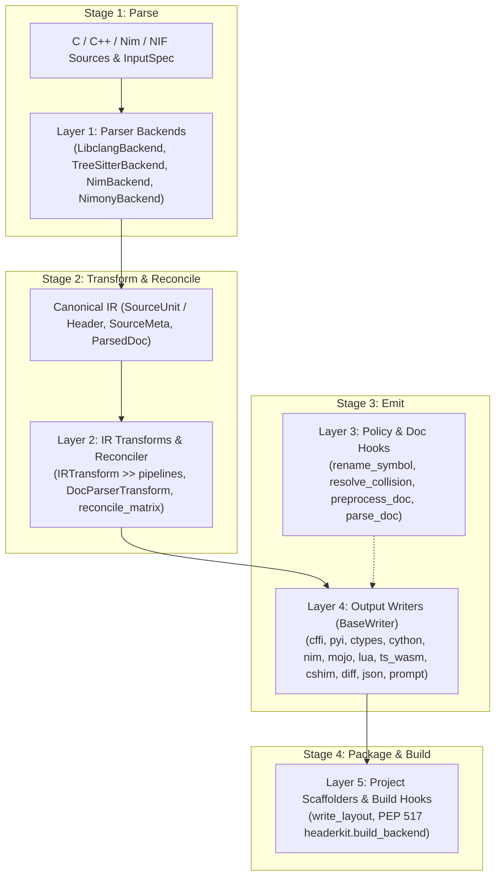

# headerkit

**The universal C/C++ interop toolkit.** Generates production-ready bindings for Python, Nim, Mojo, LuaJIT, TypeScript/Wasm, and C shims.

headerkit parses C and C++ header files into a language-agnostic Intermediate Representation (IR), then transforms that IR into various output formats. Use it to generate FFI bindings, serialize header metadata to JSON, or build your own custom code generators.

## Key Features

- **Pluggable parser backends** -- swap between parsing implementations (libclang ships built-in) without changing your code
- **Dataclass-based IR** -- a clean, inspectable Python representation of C/C++ declarations: structs, functions, enums, typedefs, and more
- **Pluggable output writers** -- generate CFFI bindings, ctypes modules, Cython `.pxd` files, LuaJIT FFI bindings, JSON, API diffs, LLM-optimized prompts, or write your own writer for any target format
- **Registry pattern** -- backends and writers self-register, making the system extensible without modifying core code

## Quick Example

```python
from headerkit import get_backend, get_writer

# Parse a C header
backend = get_backend()
header = backend.parse(
    open("mylib.h").read(),
    "mylib.h",
)

# Generate CFFI bindings (default writer)
writer = get_writer("cffi")
cdef_source = writer.write(header)

# Or pick another built-in writer
ctypes_writer = get_writer("ctypes")  # Python ctypes bindings
cython_writer = get_writer("cython")  # Cython .pxd declarations
lua_writer = get_writer("lua")  # LuaJIT FFI bindings
json_writer = get_writer("json", indent=2)  # JSON for inspection
prompt_writer = get_writer("prompt")  # Token-optimized LLM context

print(json_writer.write(header))
```

## How It Works



1. **Parser Backends** (`LibclangBackend`, `TreeSitterBackend`, `NimBackend`, `NimonyBackend`) parse C/C++/Nim/NIF source code into a normalized `SourceUnit` (`Header`) IR containing typed declarations, `SourceMeta`, and raw docstrings.
2. **IR Transforms & Reconcilers** (`IRTransform`, `DocParserTransform`, `reconcile_matrix`) filter, unmangle, parse structured documentation (`ParsedDoc`), or merge multi-target IR trees before emission.
3. **Fine-Grained Policy & Doc Hooks** (`rename_symbol`, `resolve_collision`, `preprocess_doc`, `parse_doc`) apply priority-ordered naming, casing, collision, and docstring parsing rules.
4. **Output Writers** (`BaseWriter` subclasses) consume the pure IR (with zero backend dependencies) to emit bindings.
5. **Project Scaffolders & Build Hooks** (`write_layout()`, `headerkit.build_backend`) emit complete package layouts and build wheels using the `.headerkit/` two-layer cache.

## Next Steps

<div class="grid cards" markdown>

-   **Installation**

    ---

    Install headerkit and its system dependency (libclang).

    [:octicons-arrow-right-24: Installation](guides/installation.md)

-   **Quick Start**

    ---

    Parse your first header and generate bindings in under five minutes.

    [:octicons-arrow-right-24: Quick Start](guides/quickstart.md)

-   **Architecture**

    ---

    Understand the three-layer backend/IR/writer architecture.

    [:octicons-arrow-right-24: Architecture Overview](guides/architecture.md)

-   **Cache System**

    ---

    Two-layer cache for libclang-free builds.

    [:octicons-arrow-right-24: Cache Guide](guides/cache.md)

-   **Build Backend**

    ---

    PEP 517 build backend for libclang-free installs via pip.

    [:octicons-arrow-right-24: Build Backend Guide](guides/build-backend.md)

-   **API Reference**

    ---

    Full reference for all IR types, backends, and writers.

    [:octicons-arrow-right-24: API Reference](reference/index.md)

</div>
